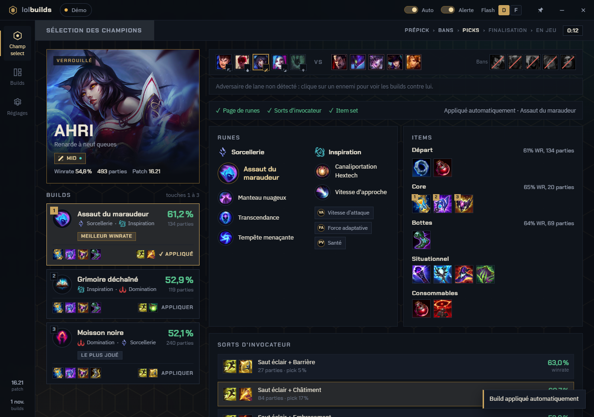
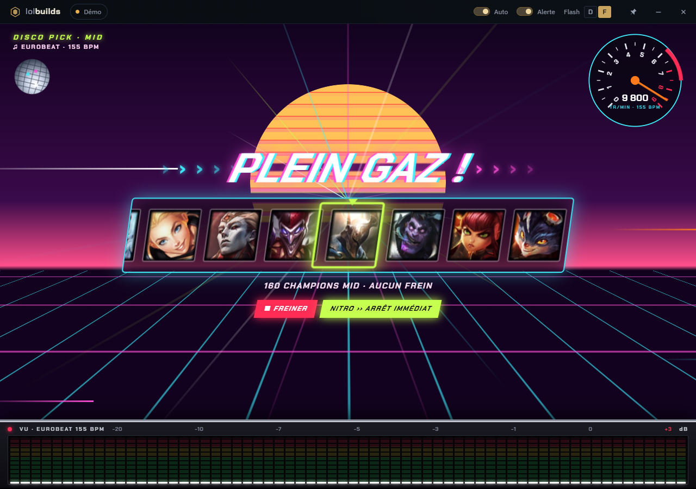
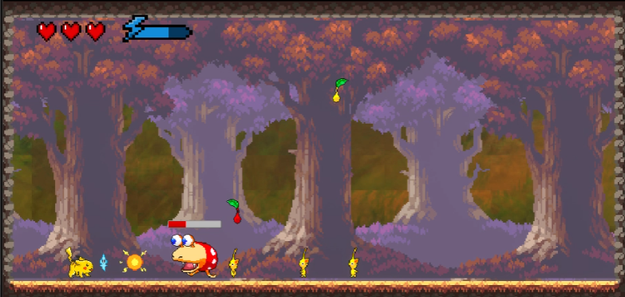
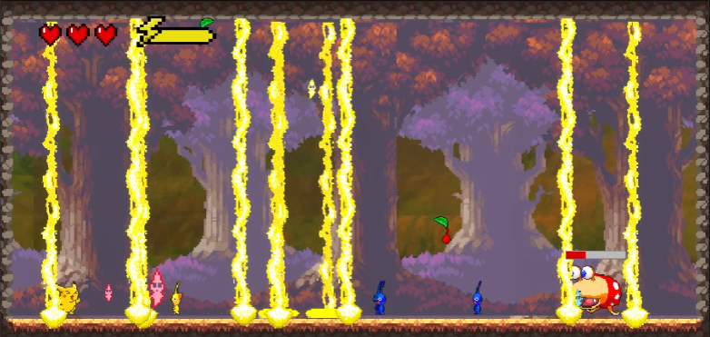

<h1 align="center">Salut, moi c'est Miitos 👋</h1>

  <b>Développeur</b>, je code au boulot et je continue le soir sur mes projets perso : 
  du firmware ESP32 au widget Windows, en passant par un assistant pour League of Legends et un jeu Unreal.

  

---

## 🎮 [lolbuilds](https://github.com/Miitos/lol-autobuilder)

Tes runes, sorts et item set appliqués tout seuls en champ select League of Legends, d'après les stats d'OP.GG. Builds adaptés à ton adversaire de lane, picks et bans suggérés, infos sur les joueurs de la partie, mode ARAM… et une roulette **Disco pick** 🪩 pour les jours où tu veux laisser le hasard choisir.

  
  

  
  
  

---

## 🌀 Ventilo connecté

Mon ventilateur de plafond n'avait qu'une télécommande radio : je lui ai fabriqué une passerelle Wi-Fi et une appli Windows.

<table>
  <tr>
    <td width="50%" valign="top">
      <h3>🖥️ <a href="https://github.com/Miitos/ventilo-widget">ventilo-widget</a></h3>
      
Une icône dans la barre de Windows 11 pour piloter le ventilateur, avec l'état synchronisé en direct et des thèmes de saison animés.

      

        
        
      

      <h3>📡 <a href="https://github.com/Miitos/ventilo-controller">ventilo-controller</a></h3>
      
Passerelle ESP32 + CC1101 qui pilote le ventilateur en 433 MHz via HTTP, et décode aussi la télécommande d'origine pour garder l'état réel.

      

        
        
        
      

    </td>
    <td width="50%" valign="top" align="center">
      
    </td>
  </tr>
</table>

---

## ⚡ [pikachuVSpikmin](https://github.com/Miitos/pikachuVSpikmin)

Un jeu d'action 2D en pixel art sous Unreal Engine : Pikachu traverse une forêt d'automne, affronte des hordes de Pikmin et un Bombardon géant à coups d'éclairs… jusqu'au Tonnerre qui balaie tout l'écran ⚡

  
  

  

---

## 📊 Stats

  

  

